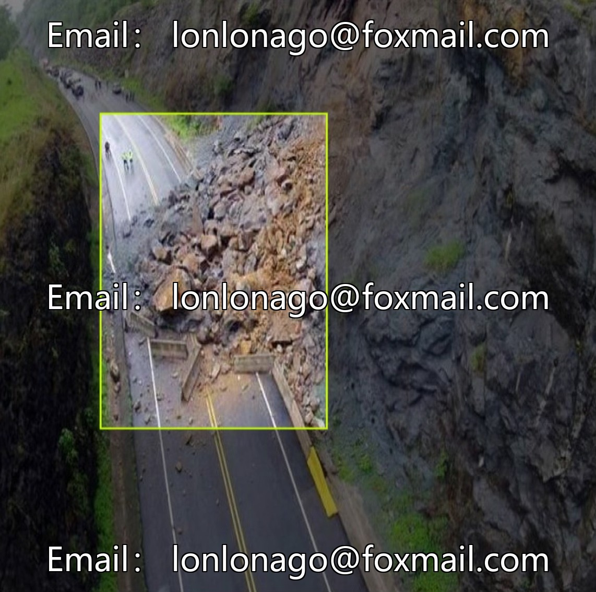
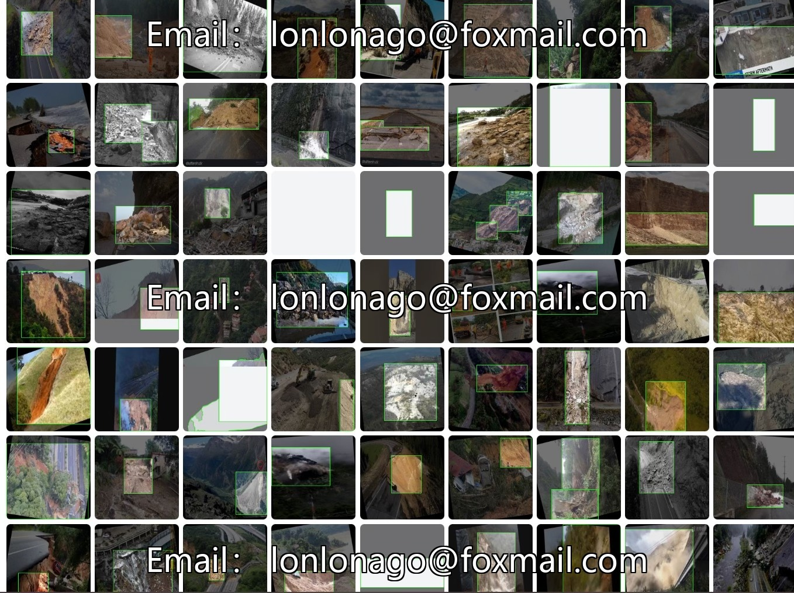
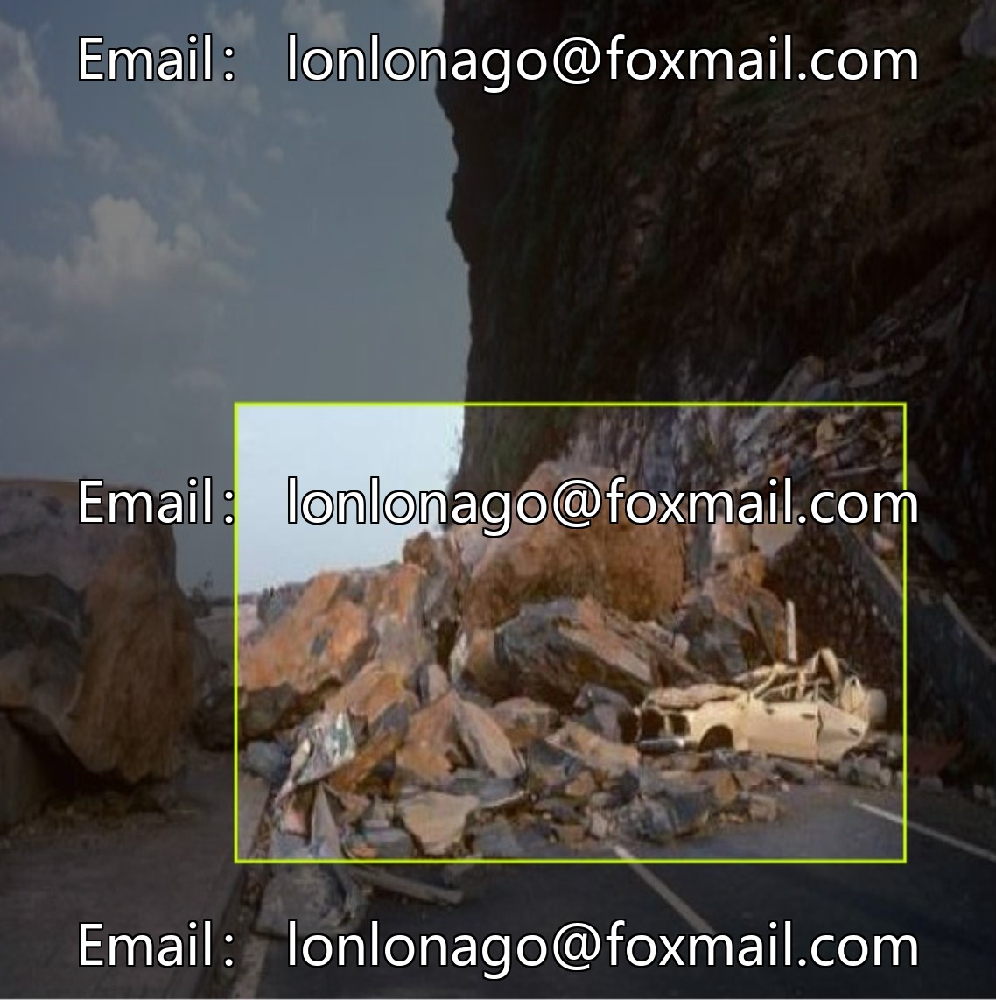
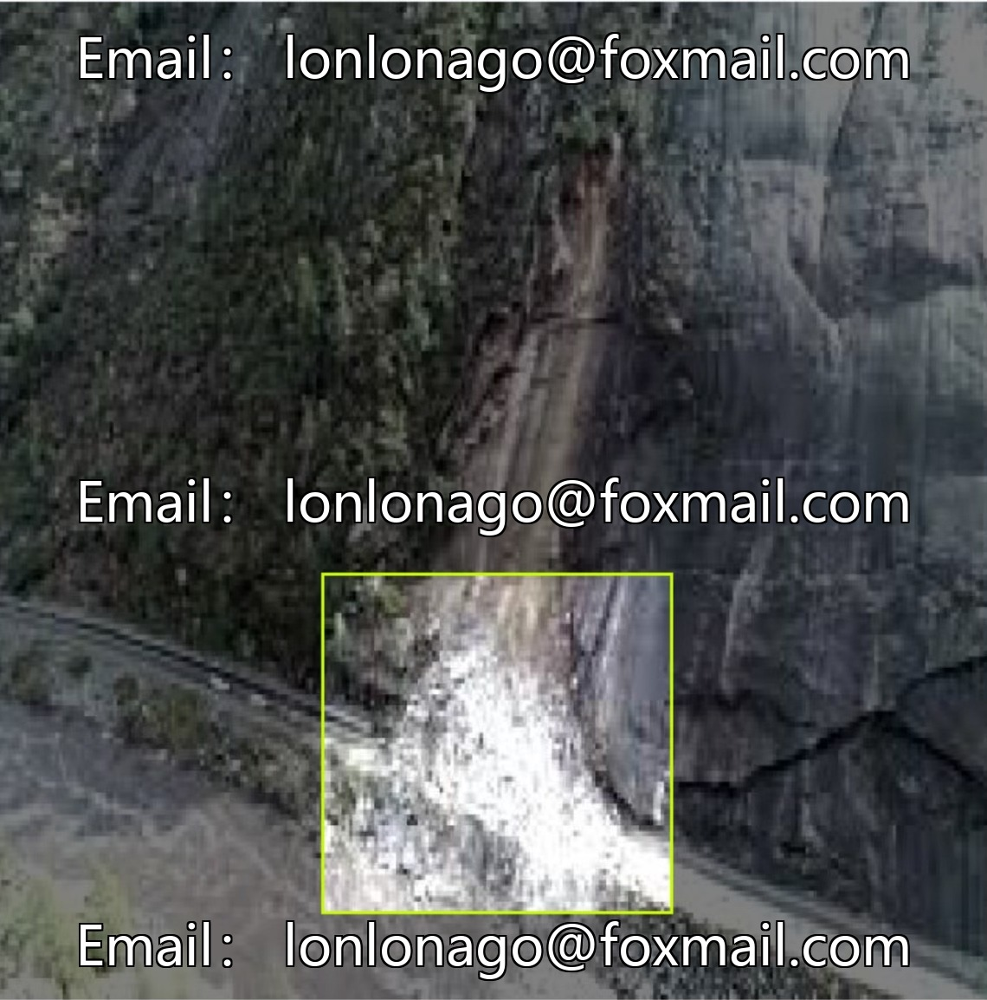
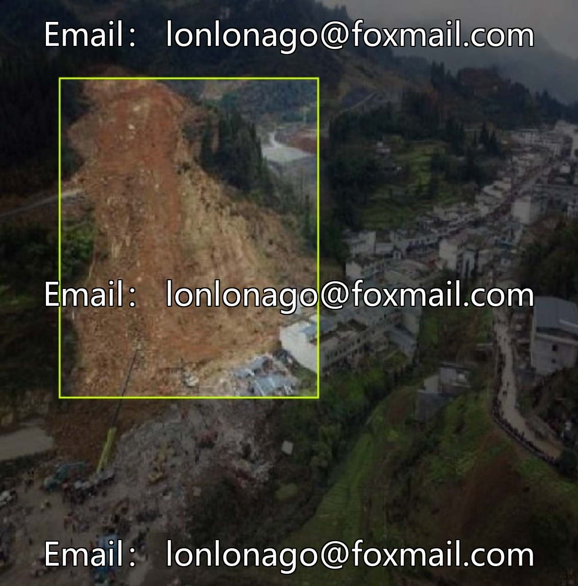
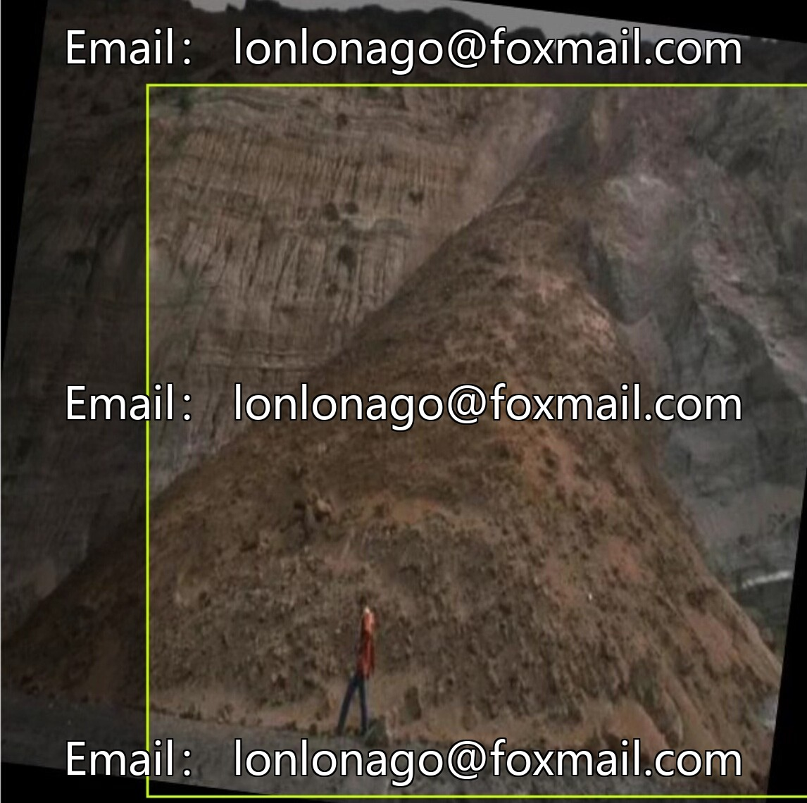
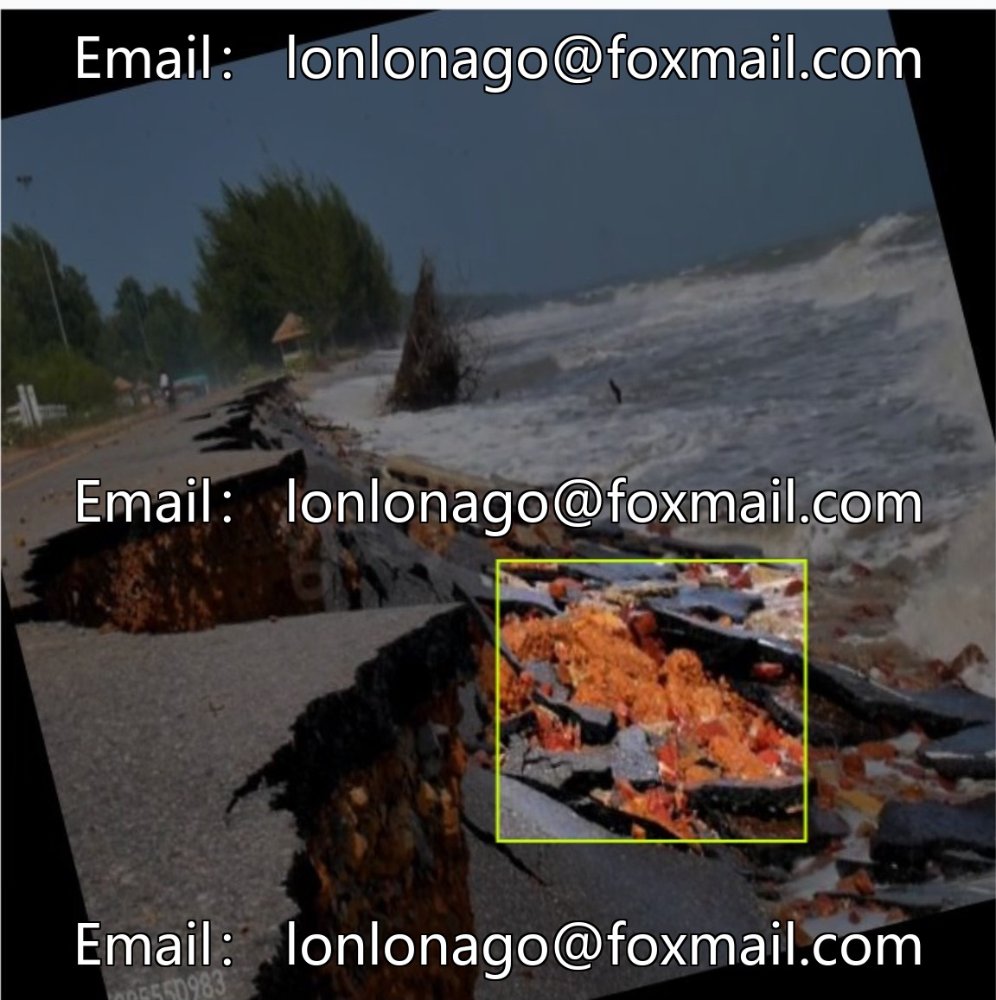

# Intelligent Highway Slope Disaster Monitoring Mountain Landslide Monitoring Data Set, Improving the Yolo Version 10

## Body

Intelligent Highway Slope Disaster Monitoring Mountain Landslide Monitoring Data Set, Improved Yolo Issue 10312, Landslide Data Set

The dataset consists of 6,709 images, with the core annotation categories being landslide (English) / landslide (Chinese). It supports instance-based training and is compatible with mainstream deep learning frameworks. The data covers various landslide forms and environmental backgrounds, suitable for scenarios such as pixel-level localization in landslide areas, geological disaster monitoring and early warning, and remote sensing image landslide feature extraction. It enhances the accuracy of disaster identification and promotes the implementation of AI solutions.

Virtual materials, once sold, are non-refundable.
Interested friends, click "I want" to proceed.

## Images

## Payment

Here is a pay link on Stripe ( https://buy.stripe.com/3cs8yP7sY87d0vu9AB ). Please contact me lonlonago@foxmail.com after funding $89, and I will send you a complete data files , thank you!

